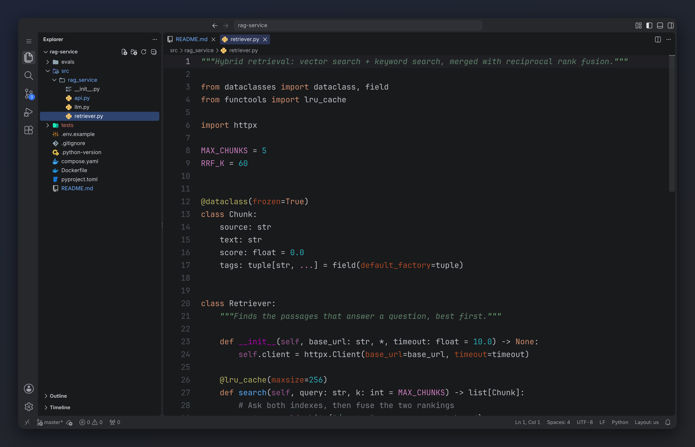
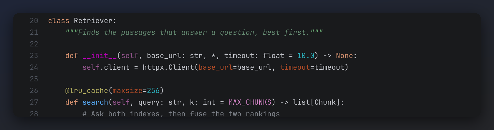
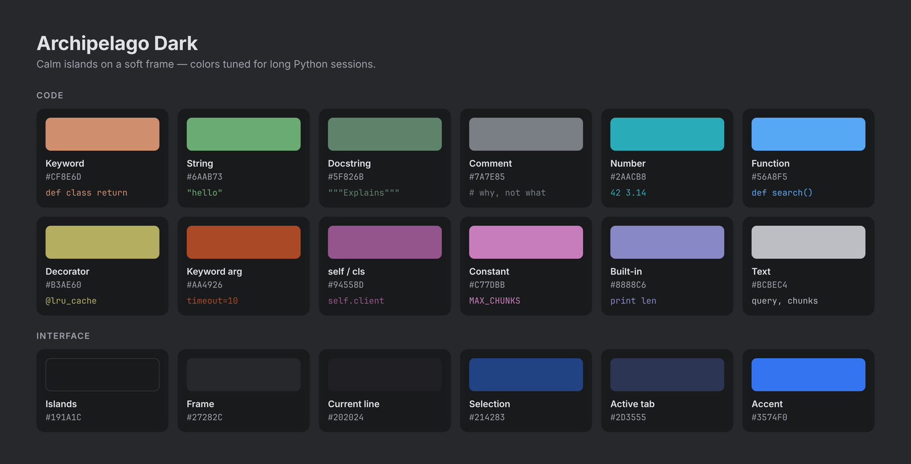

# Archipelago Dark

**A calm dark theme of floating islands, inspired by JetBrains' Islands UI and tuned for Python.**



Archipelago Dark brings the look of the new JetBrains Islands UI to VS Code: rounded panels
resting on a slightly lighter frame, a soft blue pill for the active tab, and the editor colors
PyCharm users know by heart. Every color was measured from the real thing and checked side by
side, so switching between the two editors feels like one tool.

## Highlights

- **Islands layout.** Built for VS Code's modern floating panels: no bright outlines, just calm
  panels on a soft frame.
- **Python done right.** Keywords, decorators, keyword arguments, `self`, docstrings, f-strings
  and built-ins each get their own color, exactly where a JetBrains user expects them. Ordinary
  names stay plain, so the structure of the code stands out.
- **Easy on the eyes.** Low-glare backgrounds, muted accents, no neon. Made for long sessions.
- **Beyond Python.** Clean colors for JSON, YAML, TOML, Markdown, shell scripts, HTML and
  `.env` files.



## Install

1. Open the Extensions view (`Cmd+Shift+X` on macOS, `Ctrl+Shift+X` on Windows/Linux).
2. Search for **Archipelago Dark** and click **Install**.
3. Press `Cmd+K Cmd+T` (`Ctrl+K Ctrl+T`) and choose **Archipelago Dark**.

From a terminal: `code --install-extension aymenhammami.archipelago-theme`

## Get the full look (optional)

Paste into your `settings.json` (Command Palette → **Preferences: Open User Settings (JSON)**):

```jsonc
{
  "workbench.colorTheme": "Archipelago Dark",

  // Rounded "pill" for the active tab (VS Code's modern UI)
  "workbench.experimental.modernUIEditorTabStyle": "pill",

  // JetBrains Mono, free: https://www.jetbrains.com/lp/mono/
  "editor.fontFamily": "'JetBrains Mono', monospace",
  "editor.fontSize": 15,
  "editor.fontWeight": "500",
  "editor.lineHeight": 1.6,
  "editor.fontLigatures": false,

  // The calm, JetBrains-style editor
  "editor.bracketPairColorization.enabled": false,
  "editor.guides.indentation": false,
  "editor.minimap.enabled": false,
  "explorer.compactFolders": false,
  "explorer.decorations.badges": false
}
```

For matching file icons, install
[Atom Material Icons](https://marketplace.visualstudio.com/items?itemName=AtomMaterial.a-file-icon-vscode)
and set `"workbench.iconTheme": "a-file-icon-vscode"`.

> **Why font weight 500?** VS Code draws text thinner than JetBrains IDEs do. JetBrains Mono's
> Medium weight closes the gap; try `"550"` if you want it even closer.

## Palette



## FAQ

**Why do class names and function calls stay plain?**
That's the JetBrains style: color marks structure (keywords, definitions, decorators, keyword
arguments), and everything else stays easy-to-read plain text. To get there, the theme turns off
*semantic highlighting*, so language servers like Pylance don't recolor every name. Prefer it
on? Add `"editor.semanticHighlighting.enabled": true`.

**Is there a light version?**
Not yet. [Open an issue](https://github.com/ayminovitch/archipelago-theme/issues) if you'd
use one.

**A color looks wrong in my language.**
Please [open an issue](https://github.com/ayminovitch/archipelago-theme/issues) with a
screenshot and the language name.

## Credits

Made by [Aymen Hammami](https://aymen-hammami.com). Inspired by the Islands theme in JetBrains
IDEs. Archipelago Dark is an independent project and is not affiliated with or endorsed by
JetBrains; JetBrains and PyCharm are trademarks of JetBrains s.r.o.

[MIT License](LICENSE)
